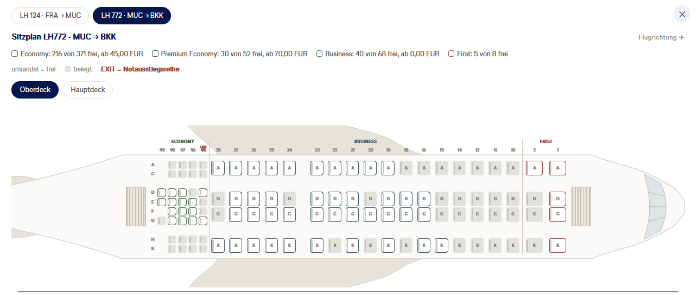
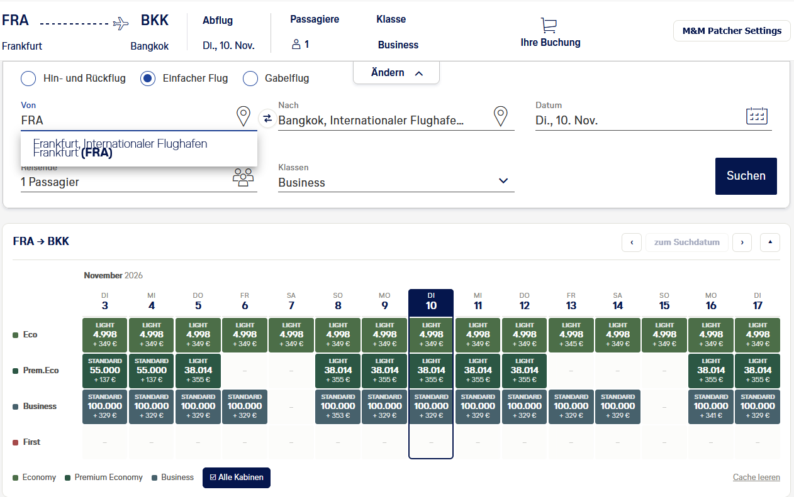

  <picture>
    <source media="(prefers-color-scheme: dark)" srcset="assets/banner-dark.png">
    
  </picture>

  

  
  
  

Userscript für die Prämienflugsuche auf miles-and-more.com. Es zeigt den Kalender für alle vier Kabinen,
zu jedem Flug die Seatmap mit freien Plätzen, kennt 11.000 Flughäfen statt 1.500 und findet über das
Buchungsbüro Partnerawards, die M&M sonst nicht anzeigt.

---

## Installation

1. [Tampermonkey](https://www.tampermonkey.net/) installieren (Chrome, Firefox, Edge).
   Violentmonkey und Greasemonkey funktionieren ebenfalls.

   1a. Chrome only: URL eingeben: [chrome://extensions](chrome://extensions) -> Tampermonkey -> Details: "Nutzerscripte zulassen" aktivieren

   1b. Safari: statt Tampermonkey [Userscripts](https://apps.apple.com/de/app/userscripts/id1463298887) aus dem App Store installieren, dann Safari -> Einstellungen -> Erweiterungen: Userscripts aktivieren

2. [**mm-searchbar.user.js**](https://raw.githubusercontent.com/wedge256/mm-patcher/main/mm-searchbar.user.js)
   anklicken - Tampermonkey öffnet den Installationsdialog

   2a. Safari: Userscripts-Symbol in der Symbolleiste anklicken -> installieren, beim ersten Besuch auf M&M den Zugriff erlauben

Alle Funktionen lassen sich einzeln abschalten: Knopf "M&M Patcher Settings" oben
rechts auf der Ergebnisseite.

---

## Funktionen

### Sitzplan

- **Seatmaps für jeden Flug**

  Ein Klick auf den Flugzeugtyp öffnet den Sitzplan und zeigt, welche Plätze noch frei sind.

  

### Mehr Flüge finden

- **Buchungsbüro wählen**

  Das Buchungsbüro entscheidet mit, welche Flüge M&M anzeigt. Es richtet sich nicht
  nach IP oder Wohnsitz, sondern nach dem Abflugort der Suche. Je nach Büro tauchen
  Partnerawards auf, die sonst fehlen: DE findet z. B. keine Ethiopian-Flüge ab
  Deutschland, AT oder CH schon. Voreingestellt ist "Automatisch (Abflugland)",
  umstellbar in den Settings.

### Suche

- **Suchmaske**

  Ein Swap-Knopf dreht Start und Ziel. Auch nach Orten, die die originale Prämiensuche gar
  nicht kennt, lässt sich jetzt suchen.
  Den "Ändern"-Button hat M&M inzwischen selbst wieder freigeschaltet; falls er
  erneut verschwindet, holt das Script ihn zurück.

- **Verbesserte Flughafensuche**

  "BER" findet Berlin statt Berbera, "FRA" Frankfurt statt Francistown. Ein
  Ländername wie "Japan" listet alle Städte des Landes.

- **Erweiterte Flughafenliste**

  Erweitert die kastrierte Prämienliste von ~1.500 auf 11.161 Orte, dazu Bahnhöfe und
  Städte ohne Flughafen wie z.B. AGY (Augsburg) und KNC (Konstanz Bahnhof).

- **Suche ab der Hauptseite**

  Die Suchmaske auf miles-and-more.com sucht auch mit weniger als 1.500 Prämienmeilen.
  "Letzte Suchanfragen" bleiben nach dem Abmelden erhalten und erscheinen auch ohne
  frische Anmeldung. Meldet sich ein anderes Konto an, wird die Liste geleert.

- **Suchlimit im Blick**

  M&M erlaubt etwa 40 Suchen je IP-Adresse und Stunde, danach ist die Adresse eine
  Stunde gesperrt. Ein Zähler zeigt den Stand und lässt sich nach IP-Wechsel leeren.

### Kalender

- **Größerer Kalender**

  15 Tage statt 7, zum Blättern, auf Wunsch für alle vier Kabinen. Ein Klick auf
  einen Tag sucht direkt in dieser Kabine. Dazu die Bestpreise des ganzen Jahres von
  der M&M-Hauptseite (nicht für jede Route verfügbar und oft veraltet).

  

### Ergebnisse

- **Übersichtliche Ergebniskarten**

  Zeitleiste und Umsteigezeiten sind übersichtlicher dargestellt, dazu das eingesetzte
  Flugzeug samt Besonderheiten (Allegris, Retrofit-Business in der A380). Alle Tarife
  je Kabine nebeneinander, mit den noch freien Plätzen, soweit M&M sie herausgibt.

- **Zuzahlung in Euro**

  Auch gerade keine Ahnung, wie viel 2.330.434.500 Argentinische Pesos heute sind?
  Beträge in Fremdwährung zeigen jetzt den umgerechneten Euro-Betrag an.

- **Sortieren und filtern**

  Nach Meilen, Zuzahlung, Abflug oder Dauer, gerechnet in der gesuchten Kabine. Dazu
  ein Filter nach Reiseklasse.

- **Mehrere Reisende**

  Preise wahlweise pro Erwachsener oder gesamt; in den Tarifdetails stehen die Summe
  und der Preis für Kinder und Kleinkinder.

### Buchen

- **"Ich fliege nicht selbst"**

  Buchen für andere direkt im Shop, im Dialog "Reisende" - nicht mehr nur auf der
  Hauptseite.

- **Angemeldet bleiben**

  Verhindert vorzeitigen Logout, wenn man mal 15 Minuten Kaffee holen ist.

- **Entschuldigung, das bereitgestellte Vielfliegerprofil ist falsch**

  Diese eine Meldung bekommt man für JEDEN Fehler einer Sitzung. Das Script ersetzt sie
  durch eine Seite, die meistens das tatsächliche Problem nennt.

---

## Hinweise

Kein offizielles Angebot der Lufthansa Group / Miles & More.

## Unterstützen

Gefällt dir M&M Patcher? [🍺 Bier spendieren](https://buymeacoffee.com/wedge_mm)

## Lizenz

[PolyForm Strict 1.0.0](LICENSE.md): private, nichtkommerzielle Nutzung erlaubt. Weitergeben und Verändern nicht erlaubt, auch nicht unter anderem Namen.
