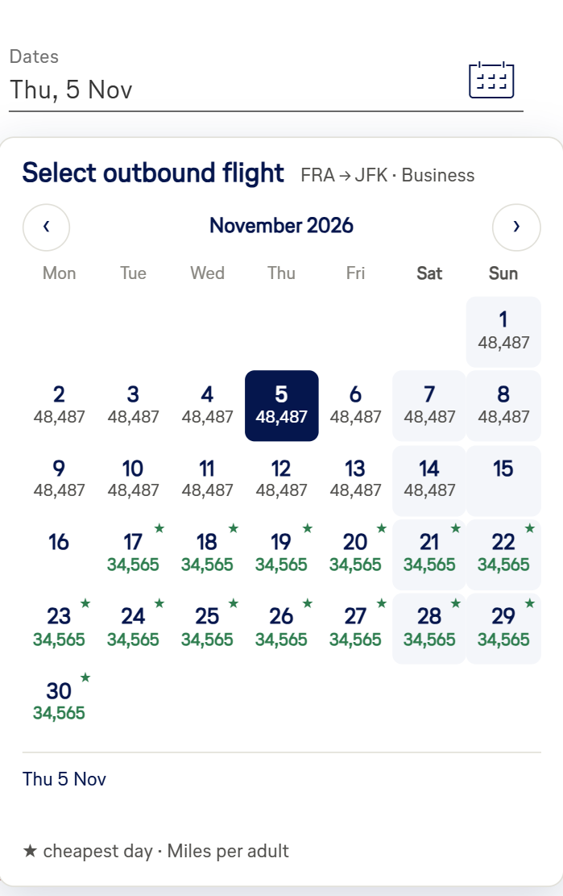
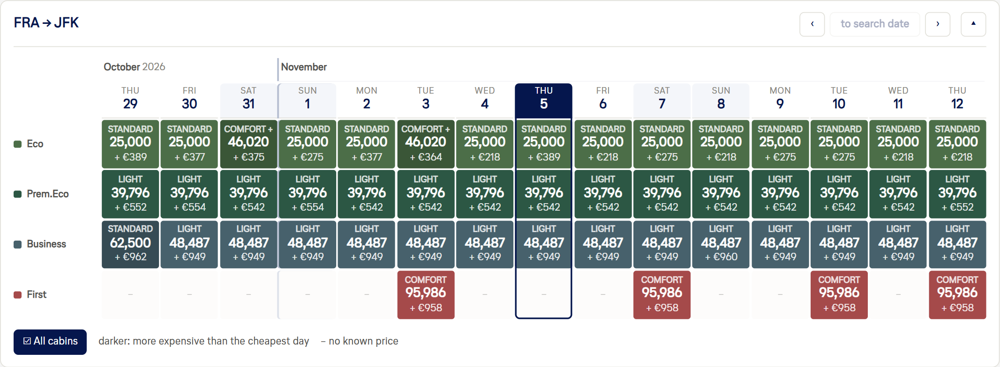
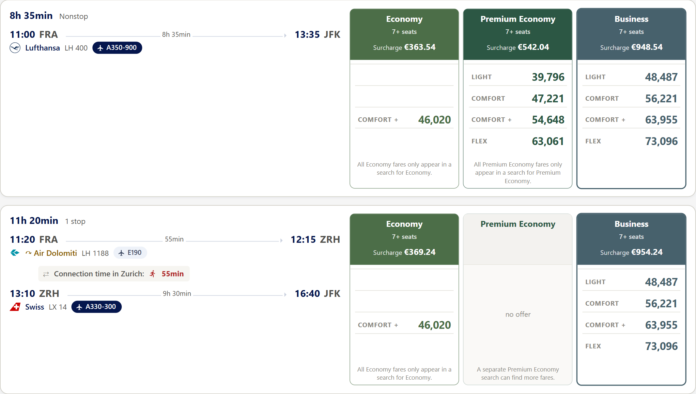
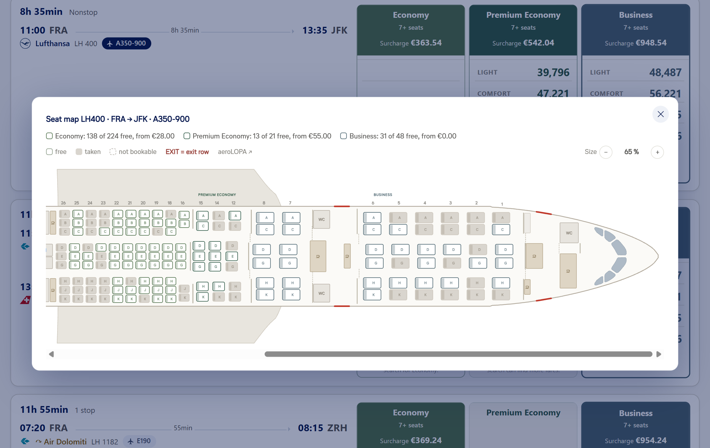

  <picture>
    <source media="(prefers-color-scheme: dark)" srcset="assets/banner-dark-en.png">
    
  </picture>

<b>English</b> · <a href="README.de.md">Deutsch</a>

  

  
  
  

Userscript for the award flight search on miles-and-more.com. It shows the calendar for all four
cabins, the seat map with free seats for every flight, knows 11,000 airports instead of 1,500 and,
through the booking office, finds partner awards that M&M otherwise hides.

---

## Installation

1. Install [Tampermonkey](https://www.tampermonkey.net/) (Chrome, Firefox, Edge).
   Violentmonkey and Greasemonkey work as well.

   1a. Chrome: open [chrome://extensions](chrome://extensions) → Tampermonkey → Details:
   enable “Allow user scripts”

   1b. Safari: instead of Tampermonkey install [Userscripts](https://apps.apple.com/app/userscripts/id1463298887)
   from the App Store, then Safari → Settings → Extensions: enable Userscripts

2. Click [**mm-patcher.user.js**](https://raw.githubusercontent.com/wedge256/mm-patcher/main/mm-patcher.user.js)
   – Tampermonkey opens its install dialog

   2a. Safari: click the Userscripts icon in the toolbar → install, allow access on your first visit
   to M&M

Every feature can be switched off on its own: the **M&M Patcher** button (with the patch) at the top
right of the results page.

---

## Features

### Search

- **Access restriction lifted**

  The search form on miles-and-more.com also searches with fewer than 1,500 award miles.

- **Extended airport list**

  Extends the trimmed award list from ~1,500 to 11,161 places, including railway stations and cities
  without an airport such as AGY (Augsburg) and KNC (Konstanz station).

- **Better airport search**

  “BER” finds Berlin instead of Berbera, “FRA” Frankfurt instead of Francistown. A country name such
  as “Japan” lists every city of that country.

- **Search form**

  A swap button turns origin and destination around.

- **Date picker with prices**

  The date field shows one month with the mile price per day, outbound and return as one range
  with the number of nights.

  

- **“I am not travelling myself”**

  Book for others right in the shop, in the “Passengers” dialog, not only on the main site.

- **Saved searches (main site)**

  “Recent searches” are kept even after logging out.

- **Search limit at a glance**

  M&M allows about 37 searches per IP address and hour; after that the address is blocked for an
  hour. A counter shows where you stand and can be reset after an IP change.

### Calendar

- **Bigger calendar**

  15 days instead of 7, for all four cabins if you like.
  On top, the best prices of the whole year from the M&M main site (“Best-By-Day” API; not available
  for every route and often outdated).

  

### Results

- **Clear result cards**

  Timeline and connection times are laid out more clearly, along with the aircraft and its specials
  (Allegris, retrofitted business in the A380). All fares of each cabin side by side, showing the
  seats still bookable.

  

- **Seat map for every flight**

  A click on the aircraft type opens the seat map and shows which seats are still free.

  

### Booking office & currency

- **Choose the booking office**

  The booking office helps decide which flights M&M shows and which currency is charged. It usually
  follows the departure point of the search. Depending on the office, partner awards appear that are
  missing otherwise: DE, for example, finds no Ethiopian flights from Germany – AT or CH do. The
  default is “Automatic (departure country)”, changeable in the settings.
  Another booking office does not change prices or miles.

- **Surcharge in a selectable currency**

  For anyone else who has no idea what 782,773.36 Argentine pesos are worth in € today: amounts in a
  foreign currency show the converted amount, in euros by default, changeable in the settings.

### Other

- **Stay logged in**

  Prevents an early logout when you're off getting coffee for 15 minutes.

- **“Sorry, the frequent flyer profile provided is incorrect”**

  You get this one message for EVERY error of a session. The script replaces it with a page that
  usually names the actual problem.

---

## Languages

The interface follows the language of the site, in all languages Miles & More offers.
Switch seamlessly at any time if you need to.

(Apart from German and English the translations are machine-made. Improvements are welcome as an
[issue](https://github.com/wedge256/mm-patcher/issues).)

## Notes

Not an official offer of the Lufthansa Group / Miles & More.

## Support

Do you like M&M Patcher? [🍺 Buy me a beer](https://buymeacoffee.com/wedge_mm)

## License

[PolyForm Strict 1.0.0](LICENSE.md): private, non-commercial use allowed. Redistribution and
modification not allowed, not even under another name.
